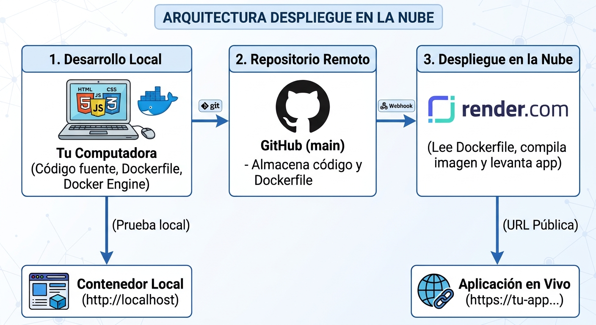

# Example Product List Web App

Aplicación web estática de lista de productos que permite **agregar** y **eliminar** productos, persistiendo la información en el `localStorage` del navegador.

**Autor:** González González Brandon
**Grupo:** 9C
**Materia:** Desarrollo web profesional
**Profesor:** Yakko Miguel Olivo Najera
**Actividad:** Pruebas y liberación del desarrollo web
**Fecha:** Tijuana, Baja California, 03 de noviembre del 2026

**Repositorio:** https://github.com/BrandonGlz/versionamiento-brandon-gonzalez
**Aplicación desplegada:** _(pendiente: URL de Render)_

---

## Objetivo de la actividad

Validar una aplicación web, contenerizarla con Docker, almacenarla en GitHub y desplegarla en la nube (Render.com), comprobando su funcionamiento en un entorno accesible públicamente.

### Entregables

1. Aplicación validada con **al menos 2 pruebas funcionales manuales**.
2. **Contenedor Docker** de la aplicación.
3. Archivos necesarios subidos a un **repositorio de GitHub**.
4. Servicio configurado en **Render.com** con la aplicación publicada.
5. **Al menos 2 pruebas automatizadas** (Selenium) sobre la aplicación desplegada.
6. **Documentación de al menos 2 páginas** con portada, conclusión, imágenes de evidencia y justificación de las decisiones técnicas.
7. Documentación entregada en **PDF**, acompañada del **PNG de arquitectura** (`[Image 1]`) y del archivo **`dockerizar_app_y_desplegarla_en_nube.txt`**.

---

## Materiales de apoyo

| Material | Descripción | Uso en la actividad |
|---|---|---|
| `Arquitectura_Despliegue_En_La_Nube.jpg` (`[Image 1]`) | Diagrama del flujo: desarrollo local → GitHub → Render → URL pública | Se incluye en la documentación y en el README |
| `dockerizar_app_y_desplegarla_en_nube.txt` | Guía paso a paso para dockerizar y desplegar en Render | Base del procedimiento de Docker y Render |
| `Actividad_ Pruebas y liberación del desarrollo WEB.docx` | Portada con los datos de la actividad | Datos para la portada de la documentación |
| Material: Pruebas de aplicaciones web (Selenium) | Material previamente compartido por el profesor | Referencia para el diseño de las pruebas automatizadas |

### Diagrama de arquitectura



Flujo:

1. **Desarrollo local:** código fuente, `Dockerfile` y Docker Engine en la computadora.
2. **Prueba local:** contenedor accesible en `http://localhost`.
3. **Repositorio remoto:** GitHub (`main`) almacena el código y el `Dockerfile`.
4. **Despliegue en la nube:** Render lee el `Dockerfile`, compila la imagen y levanta la app.
5. **Aplicación en vivo:** URL pública `https://tu-app.onrender.com`.

---

## Estado del proyecto

| Fase | Descripción | Estado |
|---|---|---|
| 0 | README con materiales y plan de trabajo | Completado |
| 1 | Pruebas funcionales manuales (mínimo 2) | Completado (4 pruebas) |
| 2 | Contenerización con Docker | Completado (build + run local) |
| 3 | Publicación en GitHub | Completado (commit `9cb54ce` publicado) |
| 4 | Despliegue en Render.com | Pendiente (requiere cuenta/URL) |
| 5 | Pruebas automatizadas con Selenium (mínimo 2) | 3 aprobadas en local; pendiente contra Render |
| 6 | Documentación en `docs/` (mínimo 2 páginas) | Completado (MD, DOCX y PDF) |
| 7 | PDF final con portada, conclusión y enlace | Borrador generado; pendiente URL de Render |

---

## Tecnologías utilizadas

| Tecnología | Uso |
|---|---|
| HTML5 | Estructura de la interfaz |
| CSS3 | Estilos y diseño |
| JavaScript (Vanilla) | Lógica de productos y persistencia |
| localStorage | Almacenamiento de productos en el navegador |
| Git / GitHub | Control de versiones y alojamiento del código |
| Docker | Contenerización de la aplicación |
| Nginx (`nginx:alpine`) | Servidor web para archivos estáticos |
| Render.com | Plataforma de despliegue en la nube |
| Python + Selenium + pytest | Pruebas automatizadas del despliegue |

---

## Estructura del proyecto

```
.
├── index.html                          # Interfaz principal
├── styles.css                          # Estilos
├── functions.js                        # Lógica de la aplicación
├── localStorage_view.png               # Evidencia del localStorage
├── Arquitectura_Despliegue_En_La_Nube.jpg  # [Image 1] Diagrama de arquitectura
├── dockerizar_app_y_desplegarla_en_nube.txt # Guía de apoyo
├── Actividad_ Pruebas y liberación del desarrollo WEB.docx # Portada
├── Dockerfile                          # Imagen Docker
├── .dockerignore                       # Exclusiones del contexto Docker
├── render.yaml                         # Configuración del servicio en Render
├── README.md                           # Bitácora de conocimiento
├── docs/                               # Documentación de la actividad (por crear)
│   ├── documentacion.md                # Documento de 2+ páginas
│   ├── documentacion.docx              # Versión editable
│   ├── documentacion.pdf               # Entrega final
│   └── img/                            # Imágenes de evidencia
└── tests/                              # Pruebas automatizadas (por crear)
    ├── test_app.py                     # Casos Selenium
    └── requirements.txt                # Dependencias de pruebas
```

---

## Funcionalidad de la aplicación

- **Agregar producto:** captura nombre y precio, valida los datos y guarda el producto con un ID incremental.
- **Eliminar producto:** elimina el producto por ID.
- **Persistencia:** los productos se guardan en `localStorage`, por lo que sobreviven a recargas de página.
- **Validaciones:** no permite nombres vacíos ni precios menores o iguales a cero.

> Nota: al usar `localStorage`, los datos son **por navegador y por dispositivo**. No existe backend ni base de datos compartida; esto es suficiente para el alcance de la práctica.

---

## Fase 1. Pruebas funcionales manuales

> Requisito: **al menos 2 pruebas manuales** ejecutadas **antes** de cualquier despliegue.

### Casos de prueba

| ID | Caso | Datos de entrada | Pasos | Resultado esperado | Evidencia | Estado |
|---|---|---|---|---|---|---|
| PM-01 | Agregar producto válido | Nombre: `Laptop`, Precio: `15000` | Abrir la app → capturar datos → clic en **Add Product** | El producto aparece en la tabla con ID `1`, nombre y precio `$15000` | `docs/img/02-manual-agregar.png` | Pendiente |
| PM-02 | Eliminar producto | Producto existente de PM-01 | Clic en **Delete** del producto | El producto desaparece de la tabla y del `localStorage` | `docs/img/03-manual-eliminar.png` | Pendiente |
| PM-03 | Validación de datos inválidos | Nombre vacío / Precio `0` | Clic en **Add Product** | Se muestra la alerta `Please enter a valid name and price.` y no se agrega nada | `docs/img/04-manual-validacion.png` | Pendiente |
| PM-04 | Persistencia | Producto existente | Recargar la página (F5) | El producto sigue visible tras la recarga | `docs/img/05-manual-persistencia.png` | Pendiente |

### Procedimiento de ejecución

```bash
# Servir la aplicación en local
python3 -m http.server 8080
# Abrir http://localhost:8080
```

### Checklist de validación local

- [x] La página carga sin errores en la consola.
- [x] Se agrega un producto válido y aparece en la tabla.
- [x] Al recargar, el producto persiste.
- [x] Se elimina un producto y desaparece de la tabla.
- [x] Los datos inválidos muestran la alerta correspondiente.
- [x] Las capturas de pantalla se guardan en `docs/img/`.

---

## Fase 2. Contenerización con Docker

### Dockerfile base (según material de apoyo)

```dockerfile
FROM nginx:alpine
COPY . /usr/share/nginx/html
EXPOSE 80
```

### Dockerfile propuesto (solo archivos necesarios)

```dockerfile
FROM nginx:alpine

COPY index.html styles.css functions.js /usr/share/nginx/html/

EXPOSE 80

CMD ["nginx", "-g", "daemon off;"]
```

### `.dockerignore` propuesto

```
.git
.gitignore
README.md
docs
tests
*.png
*.jpg
*.jpeg
*.txt
*.docx
*.pdf
```

### Comandos

```bash
# Construir la imagen
docker build -t webapp .

# Ejecutar el contenedor (usar 8081 si 8080 está ocupado)
docker run -d -p 8080:80 webapp

# Verificar
docker ps
docker logs <contenedor>

# Detener y limpiar
docker stop <contenedor>
docker rm <contenedor>
```

### Checklist de validación con Docker

- [x] La imagen se construye sin errores.
- [x] El contenedor inicia y permanece activo.
- [x] La aplicación responde en `http://localhost:8080`.
- [x] Agregar/eliminar y la persistencia funcionan dentro del contenedor.
- [x] Se capturan evidencias de `docker build`, `docker ps` y la app servida.

---

## Fase 3. Publicación en GitHub

### Preparar el repositorio

```bash
git init
git add .
git commit -m "Configurar Dockerfile para la app web"
```

### Crear repositorio en GitHub

Recomendación del material: **crearlo privado**.

### Subir el código

```bash
git branch -M main
git remote add origin https://github.com/usuario/repositorio
git push -u origin main
```

### Flujo de trabajo con ramas (aplicado en este proyecto)

```bash
git checkout -b feature/mi-cambio
# ... realizar cambios ...
git add .
git commit -m "feat: descripción del cambio"
git push -u origin feature/mi-cambio
# Crear Pull Request en GitHub y fusionar
```

### Checklist de validación en GitHub

- [x] El repositorio contiene `index.html`, `styles.css`, `functions.js`, `Dockerfile` y `README.md`.
- [x] El historial de commits refleja el trabajo realizado.
- [x] El `README.md` describe el proyecto y los pasos de despliegue.
- [x] No se exponen credenciales ni tokens en el repositorio.
- [x] Se captura evidencia del repositorio (`docs/img/06-github-repo.png`).

---

## Fase 4. Despliegue en Render.com

### Configuración del Web Service

1. Crear cuenta en [Render](https://render.com).
2. **New → Web Service** (o **New → Blueprint** si se usa `render.yaml`).
3. Conectar el repositorio de GitHub:
   - https://github.com/settings/installations/170220747
4. Configurar:
   - **Environment:** `Docker`
   - **Region:** la más cercana
   - **Instance Type / Compute:** `$0/month` (plan gratuito) — **seleccionarlo antes de desplegar**.
5. **Deploy Web Service** y esperar el build.
6. Render asigna una URL pública del tipo `https://<nombre>.onrender.com`.

El archivo `render.yaml` incluido en el repositorio define el servicio con `runtime: docker`, `plan: free`, rama `main` y `dockerfilePath: ./Dockerfile`, por lo que también puede desplegarse como Blueprint.

> El material indica que para esta app la configuración básica es suficiente. Las variables de entorno y los Secret Files son opcionales y pueden agregarse después.

### Verificación

- [ ] El servicio aparece como **Live** en Render.
- [ ] La URL pública carga la aplicación.
- [ ] Se puede agregar un producto.
- [ ] Al recargar, el producto persiste en `localStorage`.
- [ ] Se puede eliminar un producto.
- [ ] La consola del navegador no muestra errores.
- [ ] Se capturan evidencias del servicio y de la app desplegada.

### Bonus: CI/CD

```bash
git add .
git commit -m "test: comprobar despliegue automatico con CI/CD"
git push origin main
```

Observar en Render cómo se reconstruye y despliega automáticamente.

> Para eliminar o suspender el servicio: **Settings** del proyecto en Render.

---

## Fase 5. Pruebas automatizadas con Selenium

> Requisito: **al menos 2 pruebas básicas automatizadas** sobre la aplicación **desplegada**. Consultar el material **"Pruebas de aplicaciones web (Selenium)"**.

### Casos automatizados

| ID | Caso | Descripción | Resultado esperado |
|---|---|---|---|
| PA-01 | Agregar producto | Abrir la URL, capturar nombre/precio y hacer clic en **Add Product** | La fila del producto aparece en la tabla |
| PA-02 | Eliminar producto | Agregar un producto y hacer clic en **Delete** | La tabla queda sin el producto |
| PA-03 (opcional) | Persistencia | Agregar un producto y recargar la página | El producto sigue visible |

### Estructura propuesta

```
tests/
├── test_app.py
└── requirements.txt
```

`requirements.txt`:

```
selenium
pytest
```

### Esqueleto de las pruebas

```python
import os
import pytest
from selenium import webdriver
from selenium.webdriver.common.by import By
from selenium.webdriver.chrome.options import Options
from selenium.webdriver.support.ui import WebDriverWait
from selenium.webdriver.support import expected_conditions as EC

BASE_URL = os.getenv("BASE_URL", "http://localhost:8080")


@pytest.fixture
def driver():
    options = Options()
    options.add_argument("--headless=new")
    options.add_argument("--no-sandbox")
    options.add_argument("--disable-dev-shm-usage")
    driver = webdriver.Chrome(options=options)
    driver.get(BASE_URL)
    yield driver
    driver.quit()


def add_product(driver, name, price):
    driver.find_element(By.ID, "name").send_keys(name)
    driver.find_element(By.ID, "price").send_keys(str(price))
    driver.find_element(By.ID, "addProduct").click()


def test_add_product(driver):
    add_product(driver, "Laptop", 15000)
    row = WebDriverWait(driver, 10).until(
        EC.presence_of_element_located((By.CSS_SELECTOR, "#productsTable tbody tr"))
    )
    assert "Laptop" in row.text
    assert "15000" in row.text


def test_delete_product(driver):
    add_product(driver, "Mouse", 250)
    WebDriverWait(driver, 10).until(
        EC.element_to_be_clickable((By.CSS_SELECTOR, ".delete-btn"))
    ).click()
    WebDriverWait(driver, 10).until(
        EC.invisibility_of_element_located((By.CSS_SELECTOR, "#productsTable tbody tr"))
    )
```

### Ejecución

```bash
pip install -r tests/requirements.txt
BASE_URL=https://<nombre>.onrender.com pytest tests/ -v
```

> Consideración: el plan gratuito de Render suspende el servicio por inactividad. La primera petición puede tardar; usar esperas explícitas (`WebDriverWait`) y timeouts amplios.

### Checklist de validación automatizada

- [x] Selenium y pytest instalados.
- [x] Chrome/Chromedriver disponible en el entorno.
- [x] Las pruebas PA-01, PA-02 y PA-03 pasan contra el contenedor local.
- [ ] Las pruebas PA-01 y PA-02 pasan contra la URL de Render.
- [x] Se captura evidencia de la salida de `pytest` (`docs/img/11-selenium-tests.png`).

---

## Resultados de la ejecución local

### Docker

```text
$ docker build -t webapp .
$ docker run -d -p 8080:80 --name webapp-container webapp
$ docker ps --filter name=webapp-container
webapp-container   webapp   Up   0.0.0.0:8080->80/tcp

$ curl -s -o /dev/null -w "%{http_code}" http://localhost:8080/
200
```

Evidencias: `docs/img/07-docker-build.png` y `docs/img/08-docker-run.png`.

### Pruebas manuales

| ID | Resultado | Evidencia |
|---|---|---|
| PM-01 Agregar producto | Aprobado | `docs/img/02-manual-agregar.png` |
| PM-02 Eliminar producto | Aprobado | `docs/img/03-manual-eliminar.png` |
| PM-03 Validación de datos | Aprobado (alerta mostrada) | `docs/img/04-manual-validacion.png` |
| PM-04 Persistencia | Aprobado | `docs/img/05-manual-persistencia.png` |

### Pruebas Selenium

```text
$ BASE_URL=http://localhost:8080 python3 -m pytest tests/test_app.py -v
tests/test_app.py::test_add_product PASSED
tests/test_app.py::test_delete_product PASSED
tests/test_app.py::test_persistence_after_reload PASSED
========================= 3 passed in 3.95s =========================
```

Evidencia: `docs/img/11-selenium-tests.png`.

---

## Fase 6. Documentación (`docs/`)

> Requisito: documento de **al menos 2 páginas**, con **portada**, **conclusión**, **enlace a la aplicación desplegada**, imágenes de evidencia y explicación de las decisiones técnicas.

### Estructura

```
docs/
├── documentacion.md
├── documentacion.docx
├── documentacion.pdf
└── img/
    ├── portada-fondo.png
    ├── utt-logo.png
    ├── arquitectura-despliegue.png
    ├── 01-app-local.png
    ├── 02-manual-agregar.png
    ├── 03-manual-eliminar.png
    ├── 04-manual-validacion.png
    ├── 05-manual-persistencia.png
    ├── 06-github-repo.png
    ├── 07-docker-build.png
    ├── 08-docker-run.png
    ├── 09-render-servicio.png
    ├── 10-app-desplegada.png
    └── 11-selenium-tests.png
```

### Esquema del documento

1. **Portada:** título, autor, grupo, materia, profesor y fecha.
2. **Introducción y objetivo.**
3. **Descripción de la aplicación.**
4. **Arquitectura del despliegue.**
5. **Pruebas funcionales manuales:** tabla de casos, pasos, resultados y capturas.
6. **Contenerización con Docker:** Dockerfile explicado y comandos.
7. **Publicación en GitHub.**
8. **Despliegue en Render:** configuración y URL pública.
9. **Pruebas automatizadas con Selenium:** casos, código y resultados.
10. **Decisiones técnicas.**
11. **Conclusión.**
12. **Anexos:** evidencias y enlaces.

### Checklist de documentación

- [x] El documento tiene al menos 2 páginas (13 páginas).
- [x] Incluye portada con los datos de la actividad.
- [x] Incluye conclusión.
- [ ] Incluye el enlace a la aplicación desplegada (placeholder pendiente).
- [x] Incluye imágenes de evidencia locales.
- [x] Explica las decisiones técnicas.
- [x] Se genera la versión PDF para entrega.
- [x] Se adjuntan el PNG `[Image 1]` y el TXT de apoyo.
- [ ] Se actualiza el PDF con la URL final de Render.

---

## Decisiones técnicas

| Decisión | Alternativas consideradas | Justificación |
|---|---|---|
| **Nginx Alpine** para servir la app | Node/Express, Apache, Python HTTP server | La app es estática; Nginx es ligero, rápido, sin runtime de aplicación y la imagen `alpine` reduce el tamaño. |
| **Copiar solo los archivos necesarios** | `COPY . /usr/share/nginx/html` | Evita incluir documentación, pruebas y material de apoyo dentro de la imagen; reduce tamaño y superficie. |
| **Docker** para el despliegue en Render | Static Site, buildpack nativo | La actividad exige contenerización; Render construye directamente el `Dockerfile`, lo que garantiza reproducibilidad. |
| **localStorage** para persistencia | Backend + base de datos | No se requiere servidor ni autenticación; simplifica el alcance y demuestra persistencia del lado del cliente. |
| **Selenium + pytest + Chrome headless** | Cypress, Playwright, pruebas manuales | Selenium es estándar, multiplataforma y permite ejecutar las pruebas contra la URL pública; pytest simplifica la ejecución y los reportes. |
| **Plan gratuito de Render** | Plan pago | Suficiente para la práctica; se mitiga el arranque en frío con esperas explícitas. |
| **GitHub Flow** (ramas + Pull Request) | Trabajo directo sobre `main` | Trazabilidad de cambios y revisión previa a la integración; ya aplicado en la práctica de control de versiones. |
| **JavaScript Vanilla** | Framework (React, Vue) | No requiere build ni dependencias; facilita la imagen Docker y el mantenimiento. |
| **Documento en Markdown + DOCX + PDF** | Solo PDF, solo Word | Markdown conserva el conocimiento versionable; DOCX permite edición; PDF cumple con la entrega solicitada. |

---

## Evidencias

| Evidencia | Descripción | Estado |
|---|---|---|
| `localStorage_view.png` | Captura del `localStorage` con los productos guardados | Existente |
| `Arquitectura_Despliegue_En_La_Nube.jpg` | Diagrama de arquitectura (`[Image 1]`) | Existente |
| `docs/img/01-app-local.png` | Aplicación ejecutándose en local | Completado |
| `docs/img/02-manual-agregar.png` | Prueba manual: agregar producto | Completado |
| `docs/img/03-manual-eliminar.png` | Prueba manual: eliminar producto | Completado |
| `docs/img/04-manual-validacion.png` | Prueba manual: validación de datos | Completado |
| `docs/img/05-manual-persistencia.png` | Prueba manual: persistencia tras recarga | Completado |
| `docs/img/06-github-repo.png` | Repositorio en GitHub | Completado |
| `docs/img/07-docker-build.png` | Construcción de la imagen Docker | Completado |
| `docs/img/08-docker-run.png` | Contenedor en ejecución | Completado |
| `docs/img/09-render-servicio.png` | Servicio configurado en Render | Pendiente |
| `docs/img/10-app-desplegada.png` | Aplicación accesible públicamente | Pendiente |
| `docs/img/11-selenium-tests.png` | Salida de las pruebas automatizadas | Completado (local) |

---

## Checklist final de entrega

- [x] Aplicación validada con al menos 2 pruebas manuales documentadas (4 realizadas).
- [x] `Dockerfile` y `.dockerignore` creados y probados.
- [x] Imagen Docker construida y contenedor verificado en local.
- [x] Código y Dockerfile subidos a GitHub.
- [ ] Servicio creado en Render y estado **Live**.
- [ ] URL pública funcionando.
- [ ] Al menos 2 pruebas Selenium ejecutadas contra la URL pública (3 aprobadas en local).
- [x] Documento de `docs/` con 2+ páginas e imágenes (13 páginas).
- [x] Portada y conclusión incluidas.
- [ ] Enlace final a la aplicación incluido (placeholder pendiente).
- [x] PDF generado y verificado.
- [x] PNG `[Image 1]` y TXT de apoyo adjuntos.
- [x] Decisiones técnicas explicadas.
- [ ] `README.md` actualizado con la URL final.

---

## Bitácora de conocimiento

> Sección viva: agregar una entrada por cada sesión de trabajo, duda resuelta o aprendizaje relevante.

### Plantilla de entrada

```markdown
### YYYY-MM-DD — Tema

- **Qué hice:**
- **Comando / código clave:**
- **Problema encontrado:**
- **Solución:**
- **Aprendizaje:**
```

### 2026-11-03 — Validación inicial y estructura del proyecto

- **Qué hice:** Revisión de la aplicación (HTML, CSS, JS) y verificación de la funcionalidad con `localStorage`.
- **Comando / código clave:** `python3 -m http.server 8080`
- **Problema encontrado:** La aplicación no tiene backend; los datos no se comparten entre dispositivos.
- **Solución:** Se documenta que la persistencia es local al navegador, lo cual es suficiente para la práctica.
- **Aprendizaje:** `localStorage` almacena strings; es necesario usar `JSON.stringify` y `JSON.parse`.

### 2026-11-03 — Planificación y materiales de apoyo

- **Qué hice:** Integración del diagrama de arquitectura, la guía de dockerización/despliegue y los datos de portada.
- **Comando / código clave:** `docker build -t webapp .`
- **Problema encontrado:** El material base copia todo el proyecto dentro de la imagen.
- **Solución:** Se propone copiar solo `index.html`, `styles.css` y `functions.js`, apoyándose en `.dockerignore`.
- **Aprendizaje:** Separar la documentación y las pruebas de la imagen reduce su tamaño y mejora la seguridad.

### 2026-11-03 — Contenerización y validación local

- **Qué hice:** Creación del `Dockerfile`, construcción de la imagen `webapp` y ejecución del contenedor `webapp-container` en el puerto 8080.
- **Comando / código clave:** `docker build -t webapp .` y `docker run -d -p 8080:80 --name webapp-container webapp`
- **Problema encontrado:** El favicon generaba un error 404 en la consola del navegador.
- **Solución:** Se agregó `<link rel="icon" href="data:,">` en `index.html` y se reconstruyó la imagen.
- **Aprendizaje:** Copiar solo los archivos necesarios y usar `.dockerignore` mantiene la imagen limpia y pequeña.

### 2026-11-03 — Pruebas manuales y automatizadas

- **Qué hice:** Ejecución de 4 pruebas manuales con evidencia fotográfica y 3 pruebas automatizadas con Selenium, pytest y Chrome headless.
- **Comando / código clave:** `BASE_URL=http://localhost:8080 python3 -m pytest tests/test_app.py -v`
- **Problema encontrado:** El plan gratuito de Render puede tardar en responder por el arranque en frío.
- **Solución:** Se configuraron esperas explícitas de hasta 30 segundos en Selenium.
- **Aprendizaje:** Las pruebas automatizadas permiten repetir la validación contra local y contra la URL pública cambiando solo `BASE_URL`.

### 2026-11-03 — Documentación y PDF

- **Qué hice:** Redacción de `docs/documentacion.md`, generación de `docs/documentacion.docx` y conversión a `docs/documentacion.pdf` con portada, imágenes y conclusión.
- **Comando / código clave:** `libreoffice --headless --convert-to pdf --outdir docs docs/documentacion.docx`
- **Problema encontrado:** La portada inicial mostraba el centro negro porque el PNG de fondo tenía transparencia.
- **Solución:** Se compuso el fondo sobre un lienzo blanco antes de dibujar el texto.
- **Aprendizaje:** Es importante verificar la transparencia de las imágenes al generar documentos y PDF.

### 2026-11-03 — Publicación en GitHub

- **Qué hice:** Se publicó el commit `9cb54ce` en la rama `main` del repositorio remoto.
- **Comando / código clave:** `git push origin main`
- **Problema encontrado:** El token anterior del remoto había sido revocado (HTTP 401).
- **Solución:** Se configuró el remoto sin token y se autenticó el push con un token válido de forma temporal, sin almacenarlo en el repositorio.
- **Aprendizaje:** Nunca deben guardarse tokens en la URL del remoto ni en archivos versionados; conviene usar SSH o un credential helper.

### 2026-11-03 — Despliegue en Render (pendiente)

- **Qué hice:** Definición de la configuración del servicio en Render.
- **Comando / código clave:** `Environment: Docker`, `Instance Type: $0/month`
- **Problema encontrado:** El token actual del repositorio no es válido (HTTP 401), por lo que el push a GitHub está bloqueado.
- **Solución:** Pendiente de generar un token nuevo o configurar SSH.
- **Aprendizaje:** Render reconstruye la imagen en cada push a la rama configurada (CI/CD).

---

## Preguntas frecuentes / solución de problemas

**La página carga en blanco.**
Verificar que los nombres de archivo coincidan exactamente y que el servidor esté sirviendo desde la raíz correcta.

**Docker no encuentra el Dockerfile.**
Ejecutar `docker build` desde el directorio donde se encuentra el `Dockerfile`.

**El puerto 8080 está ocupado.**
Usar otro puerto: `docker run -d -p 8081:80 webapp`.

**Los datos desaparecen en producción.**
Es el comportamiento esperado de `localStorage`; no es un error del despliegue.

**Render no detecta el proyecto.**
Verificar que el repositorio sea público o que Render tenga permisos sobre él.

**Selenium falla por timeout contra Render.**
El servicio gratuito puede estar suspendido; la primera petición tarda en responder. Aumentar el timeout de `WebDriverWait` y reintentar.

**Chrome no inicia en el servidor de pruebas.**
Usar `--headless=new`, `--no-sandbox` y `--disable-dev-shm-usage`.

**El token de GitHub del remote no funciona.**
Generar un token nuevo o configurar SSH; el token anterior fue revocado por seguridad.

---

## Conclusión

_(Se completará en `docs/documentacion.md` y en el PDF final, una vez realizado el despliegue y las pruebas.)_

La práctica permitirá recorrer el ciclo completo de una aplicación web: validación local, empaquetado en una imagen Docker, versionado en GitHub, despliegue público en Render y verificación automatizada con Selenium, dejando evidencia documentada de cada etapa y de las decisiones técnicas adoptadas.
