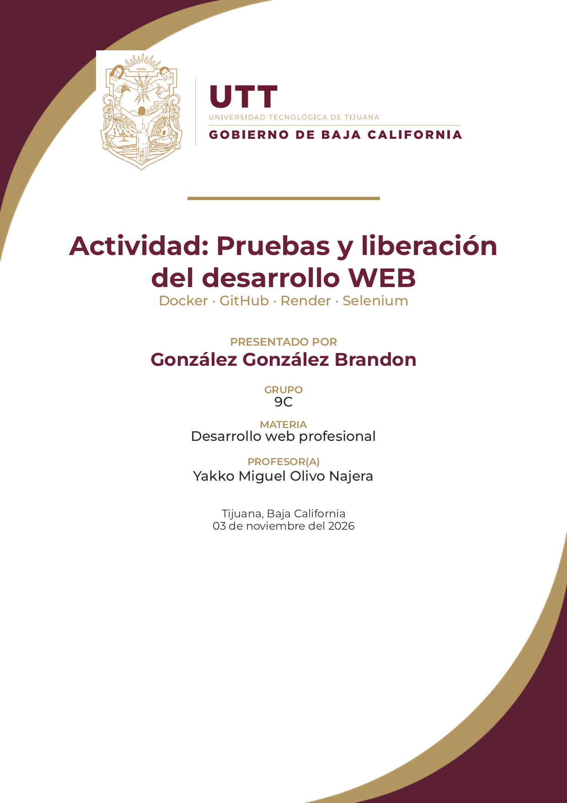
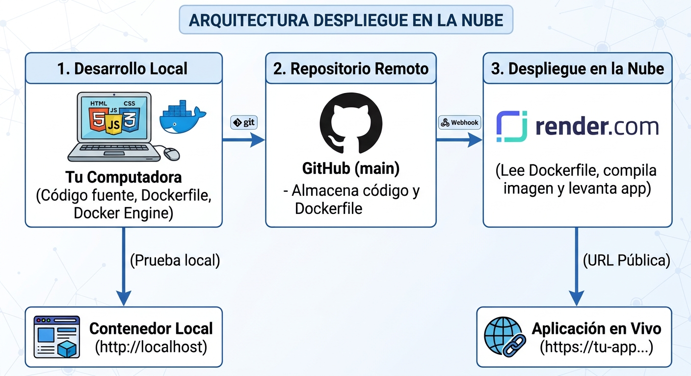
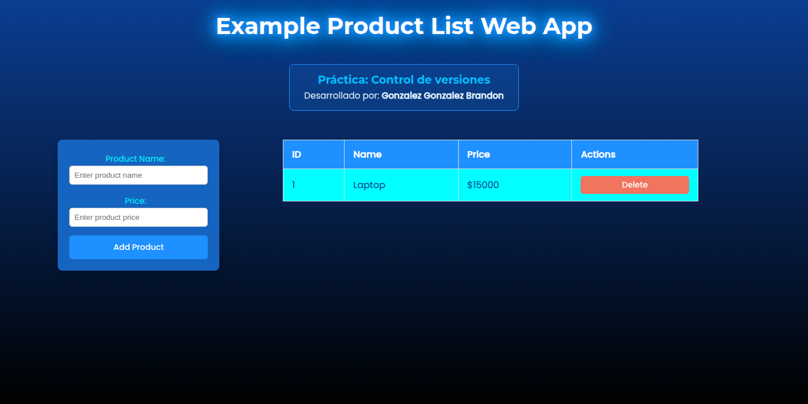
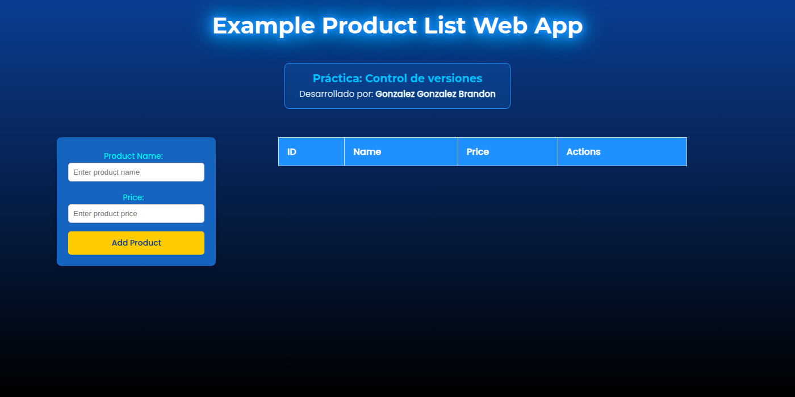
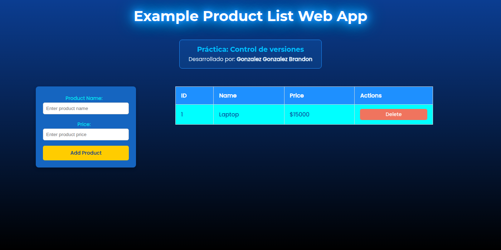
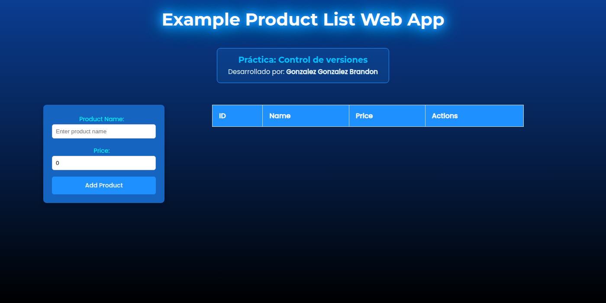
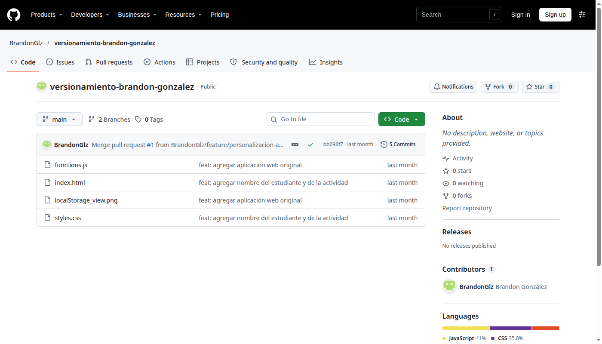

# Actividad: Pruebas y liberación del desarrollo WEB

**Presentado por:** González González Brandon
**Grupo:** 9C
**Materia:** Desarrollo web profesional
**Profesor(a):** Yakko Miguel Olivo Najera
**Fecha:** Tijuana, Baja California, 03 de noviembre del 2026

---

## Índice

1. Introducción
2. Objetivo
3. Descripción de la aplicación
4. Arquitectura del despliegue
5. Pruebas funcionales manuales
6. Contenerización con Docker
7. Publicación en GitHub
8. Despliegue en Render.com
9. Pruebas automatizadas con Selenium
10. Decisiones técnicas
11. Conclusión
12. Anexos y evidencias

---

## 1. Introducción

El presente documento describe el proceso de validación, contenerización, publicación y despliegue en la nube de una aplicación web estática de lista de productos. La aplicación fue desarrollada durante la práctica de control de versiones del primer parcial y permite agregar y eliminar productos, guardando la información en el `localStorage` del navegador.

La actividad se apoya en tres herramientas principales: Docker para empaquetar la aplicación y sus archivos en una imagen reproducible; GitHub para alojar el código fuente y el `Dockerfile`; y Render.com para publicar el contenedor y obtener una URL accesible públicamente. Adicionalmente, se utilizó Selenium con pytest para automatizar pruebas funcionales.

## 2. Objetivo

Validar una aplicación web, contenerizarla con Docker, almacenarla en GitHub y desplegarla en la nube (Render.com), comprobando su funcionamiento en un entorno accesible públicamente.

**Objetivos específicos:**

- Ejecutar al menos dos pruebas funcionales manuales antes del despliegue.
- Crear un `Dockerfile` y construir una imagen de la aplicación con Nginx.
- Verificar el funcionamiento del contenedor en local.
- Publicar el código y el `Dockerfile` en un repositorio de GitHub.
- Configurar un Web Service en Render.com usando el plan gratuito.
- Ejecutar al menos dos pruebas automatizadas con Selenium contra la aplicación desplegada.
- Documentar el procedimiento, las evidencias y las decisiones técnicas.

## 3. Descripción de la aplicación

La aplicación es una página web estática compuesta por `index.html`, `styles.css` y `functions.js`. La interfaz presenta un formulario para capturar el nombre y el precio de un producto, una tabla con los productos registrados y un botón para eliminar cada producto.

La lógica se implementa en JavaScript Vanilla. Al agregar un producto se valida que el nombre no esté vacío y que el precio sea mayor que cero; luego se asigna un ID incremental y se guarda el arreglo en `localStorage`. Al eliminar, se filtra el producto por ID y se actualiza el almacenamiento. La tabla se reconstruye después de cada operación.

La aplicación no requiere backend ni base de datos, lo que simplifica el despliegue: el contenedor solo necesita un servidor web para entregar los archivos estáticos. La persistencia es local al navegador y al dispositivo, comportamiento esperado para el alcance de la práctica.

### Tecnologías utilizadas

| Tecnología | Uso |
|---|---|
| HTML5 | Estructura de la interfaz |
| CSS3 | Estilos y diseño |
| JavaScript Vanilla | Lógica de productos y persistencia |
| localStorage | Almacenamiento en el navegador |
| Docker | Contenerización |
| Nginx Alpine | Servidor de archivos estáticos |
| GitHub | Control de versiones y repositorio remoto |
| Render.com | Despliegue en la nube |
| Selenium + pytest | Pruebas automatizadas |

## 4. Arquitectura del despliegue

La arquitectura sigue el flujo solicitado en el material de apoyo: el código se desarrolla y se prueba en local dentro de un contenedor Docker; posteriormente se publica en GitHub; finalmente, Render detecta el repositorio, lee el `Dockerfile`, construye la imagen y levanta el servicio en la nube.



*Figura 1. Arquitectura del despliegue en la nube (material de apoyo [Image 1]).*

El flujo se compone de cinco etapas:

1. **Desarrollo local:** código fuente, `Dockerfile` y Docker Engine en la computadora.
2. **Prueba local:** el contenedor se ejecuta y se accede por `http://localhost:8080`.
3. **Repositorio remoto:** GitHub almacena el código y el `Dockerfile` en la rama `main`.
4. **Despliegue en la nube:** Render lee el `Dockerfile`, compila la imagen y levanta la aplicación.
5. **Aplicación en vivo:** Render expone una URL pública con HTTPS.

## 5. Pruebas funcionales manuales

Antes de desplegar se ejecutaron cuatro pruebas funcionales sobre la aplicación servida en local. Las pruebas se realizaron en un navegador Chromium en modo headless para dejar evidencia fotográfica de cada estado; adicionalmente, la aplicación puede verificarse manualmente abriendo la URL local.

| ID | Caso | Datos | Resultado esperado | Resultado | Evidencia |
|---|---|---|---|---|---|
| PM-01 | Agregar producto válido | Laptop / 15000 | El producto aparece en la tabla con ID 1 | Aprobado | `02-manual-agregar.png` |
| PM-02 | Eliminar producto | Producto de PM-01 | El producto desaparece de la tabla | Aprobado | `03-manual-eliminar.png` |
| PM-03 | Validación de datos inválidos | Nombre vacío / Precio 0 | Se muestra la alerta y no se agrega nada | Aprobado | `04-manual-validacion.png` |
| PM-04 | Persistencia | Producto existente | El producto sigue visible tras recargar | Aprobado | `05-manual-persistencia.png` |

En PM-01 se capturó el nombre `Laptop` y el precio `15000`; la tabla mostró el ID 1 y el precio con formato de dólar. En PM-02 se eliminó el producto y la tabla quedó vacía. En PM-03 se intentó agregar un producto sin nombre y con precio 0; la aplicación mostró la alerta `Please enter a valid name and price.` y no modificó la tabla. En PM-04 se recargó la página después de agregar un producto y este permaneció visible gracias a `localStorage`.



*Figura 2. PM-01: producto agregado correctamente.*



*Figura 3. PM-02: producto eliminado de la tabla.*



*Figura 4. PM-04: persistencia del producto tras recargar.*



*Figura 5. PM-03: estado de la aplicación después de la alerta de validación.*

## 6. Contenerización con Docker

Se creó un `Dockerfile` basado en `nginx:alpine`, una imagen ligera que incluye Nginx y los archivos necesarios para servir contenido estático. A diferencia del ejemplo base, se copiaron únicamente `index.html`, `styles.css` y `functions.js`, y se agregó un archivo `.dockerignore` para excluir documentación, pruebas y material de apoyo del contexto de construcción.

### Dockerfile

```dockerfile
FROM nginx:alpine

COPY index.html styles.css functions.js /usr/share/nginx/html/

EXPOSE 80

CMD ["nginx", "-g", "daemon off;"]
```

### .dockerignore

```
.git
.gitignore
README.md
docs
tests
*.png
*.jpg
*.jpeg
*.txt
*.docx
*.pdf
```

### Comandos ejecutados

```bash
docker build -t webapp .
docker run -d -p 8080:80 --name webapp-container webapp
docker ps
curl -s -o /dev/null -w "%{http_code}" http://localhost:8080/
```

La imagen se construyó sin errores y el contenedor se inició en el puerto 8080. Se verificó que `index.html`, `styles.css` y `functions.js` respondieran con código HTTP 200. Las pruebas funcionales se repitieron dentro del contenedor y todas fueron aprobadas.

| Verificación | Resultado |
|---|---|
| Construcción de la imagen | Exitosa (`docker build`) |
| Estado del contenedor | `Up` (`webapp-container`) |
| `index.html` | HTTP 200 |
| `styles.css` | HTTP 200 |
| `functions.js` | HTTP 200 |
| Pruebas funcionales en el contenedor | Aprobadas |


*Figura 6. Construcción de la imagen Docker.*


*Figura 7. Contenedor en ejecución y verificación HTTP.*

## 7. Publicación en GitHub

El código fuente se aloja en el repositorio <https://github.com/BrandonGlz/versionamiento-brandon-gonzalez>. El repositorio conserva el historial de cambios de la práctica de control de versiones y se utiliza como origen para el despliegue en Render.

Los comandos empleados para publicar los archivos fueron:

```bash
git init
git add .
git commit -m "Configurar Dockerfile para la app web"
git branch -M main
git remote add origin https://github.com/usuario/repositorio
git push -u origin main
```

Para el trabajo colaborativo se mantuvo el flujo de ramas utilizado en la práctica anterior: se crea una rama `feature`, se realizan los cambios, se abre un Pull Request y se fusiona con `main`. Este flujo permite revisar los cambios antes de que Render reconstruya el servicio.



*Figura 8. Repositorio del proyecto en GitHub.*

## 8. Despliegue en Render.com

Render.com se utilizó como plataforma de despliegue en la nube. El servicio se configura como un Web Service conectado al repositorio de GitHub; Render detecta el `Dockerfile`, construye la imagen y expone la aplicación mediante HTTPS.

### Configuración del servicio

| Parámetro | Valor |
|---|---|
| Tipo de servicio | Web Service |
| Repositorio | `BrandonGlz/versionamiento-brandon-gonzalez` |
| Rama | `main` |
| Entorno | Docker |
| Compute / Instance Type | `$0/month` (plan gratuito) |
| Región | La más cercana al usuario |
| Variables de entorno | No requeridas para esta aplicación |
| Secret Files | No requeridos para esta aplicación |

### Procedimiento

1. Crear una cuenta en Render.com.
2. Seleccionar **New → Web Service** y conectar el repositorio de GitHub.
3. Elegir el entorno Docker y la rama `main`.
4. Seleccionar el plan de cómputo de `$0/month` antes de desplegar.
5. Crear el servicio y esperar a que el estado cambie a **Live**.
6. Abrir la URL pública asignada por Render y verificar la aplicación.

La URL pública del servicio es: `https://TU-APP.onrender.com`. Esta URL se utiliza en las pruebas automatizadas de Selenium y se actualiza en este documento una vez que el servicio queda en estado **Live**.

El material de apoyo también menciona la posibilidad de probar CI/CD: cada push a la rama `main` dispara una nueva construcción y despliegue en Render. Para suspender o eliminar el servicio se utiliza la sección **Settings** del proyecto.


*Figura 9. Flujo de despliegue utilizado en Render.*

## 9. Pruebas automatizadas con Selenium

Se implementaron tres pruebas automatizadas con Selenium WebDriver, pytest y Chrome en modo headless. Las pruebas se ejecutaron contra la aplicación servida por el contenedor local y se configuraron para aceptar la URL de Render mediante la variable de entorno `BASE_URL`.

| ID | Caso | Descripción | Resultado |
|---|---|---|---|
| PA-01 | Agregar producto | Captura nombre y precio, hace clic en **Add Product** y verifica la fila | Aprobado |
| PA-02 | Eliminar producto | Agrega un producto, hace clic en **Delete** y verifica que la tabla quede vacía | Aprobado |
| PA-03 | Persistencia | Agrega un producto, recarga la página y verifica que siga visible | Aprobado |

### Fragmento de las pruebas

```python
def test_add_product(driver):
    add_product(driver, "Laptop", 15000)
    row = WebDriverWait(driver, 30).until(
        EC.presence_of_element_located(
            (By.CSS_SELECTOR, "#productsTable tbody tr")
        )
    )
    assert "Laptop" in row.text
    assert "15000" in row.text

def test_delete_product(driver):
    add_product(driver, "Mouse", 250)
    WebDriverWait(driver, 30).until(
        EC.element_to_be_clickable((By.CSS_SELECTOR, ".delete-btn"))
    ).click()
    WebDriverWait(driver, 30).until(
        lambda d: len(d.find_elements(
            By.CSS_SELECTOR, "#productsTable tbody tr")) == 0
    )
```

### Ejecución y resultado

```text
$ BASE_URL=http://localhost:8080 python3 -m pytest tests/test_app.py -v
tests/test_app.py::test_add_product PASSED
tests/test_app.py::test_delete_product PASSED
tests/test_app.py::test_persistence_after_reload PASSED
========================= 3 passed in 3.95s =========================
```

Las tres pruebas pasaron correctamente. Para la verificación sobre la aplicación desplegada se utiliza la misma suite cambiando `BASE_URL` por la URL de Render; se emplean esperas explícitas de hasta 30 segundos para tolerar el arranque en frío del plan gratuito.


*Figura 10. Resultado de las pruebas automatizadas con pytest y Selenium.*

## 10. Decisiones técnicas

| Decisión | Alternativas | Justificación |
|---|---|---|
| Nginx Alpine | Node, Apache, Python | La app es estática; Nginx es ligero y no requiere runtime de aplicación. |
| Copiar solo archivos necesarios | `COPY . /usr/share/nginx/html` | Reduce el tamaño de la imagen y evita incluir documentación y pruebas. |
| Docker en Render | Static Site, buildpack | Cumple el requisito de contenerización y garantiza reproducibilidad. |
| localStorage | Backend + base de datos | Suficiente para el alcance; no requiere servidor ni autenticación. |
| Selenium + pytest | Cypress, Playwright | Estándar, multiplataforma y ejecutable contra la URL pública. |
| Plan gratuito de Render | Plan pago | Costo cero; se mitiga el arranque en frío con esperas explícitas. |
| GitHub Flow | Trabajo directo en `main` | Trazabilidad y revisión mediante ramas y Pull Requests. |
| Markdown + DOCX + PDF | Solo PDF o solo Word | Markdown versiona el conocimiento; DOCX permite edición; PDF cumple la entrega. |

## 11. Conclusión

La práctica permitió recorrer el ciclo completo de una aplicación web: se validó su funcionamiento en local, se empaquetó en una imagen Docker, se publicó el código en GitHub y se preparó el despliegue en Render.com. Las pruebas manuales confirmaron que la aplicación permite agregar, eliminar y persistir productos correctamente, y las pruebas automatizadas con Selenium demostraron que la suite puede ejecutarse de forma repetible contra un contenedor.

La contenerización con Nginx Alpine resultó adecuada para una aplicación estática: la imagen es pequeña, el arranque es rápido y el despliegue es reproducible. El uso de `localStorage` simplificó la arquitectura al eliminar la necesidad de un backend, aunque implica que los datos no se comparten entre navegadores o dispositivos. Esta limitación es aceptable para el objetivo de la actividad.

El despliegue en Render.com completa el ejercicio de liberación: el servicio se conecta al repositorio, construye la imagen a partir del `Dockerfile` y publica la aplicación en una URL accesible. Como trabajo futuro se propone agregar un backend con base de datos, pruebas de integración y un pipeline de CI/CD con GitHub Actions.

## 12. Anexos y evidencias

Archivos de evidencia incluidos en `docs/img/`:

- `01-app-local.png`: aplicación ejecutándose en local.
- `02-manual-agregar.png`: prueba manual PM-01.
- `03-manual-eliminar.png`: prueba manual PM-02.
- `04-manual-validacion.png`: prueba manual PM-03.
- `05-manual-persistencia.png`: prueba manual PM-04.
- `06-github-repo.png`: repositorio en GitHub.
- `07-docker-build.png`: construcción de la imagen Docker.
- `08-docker-run.png`: contenedor en ejecución y verificación HTTP.
- `11-selenium-tests.png`: salida de las pruebas automatizadas.
- `localstorage-view.png`: evidencia del `localStorage`.

**Enlaces:**

- Repositorio: <https://github.com/BrandonGlz/versionamiento-brandon-gonzalez>
- Aplicación desplegada: `https://TU-APP.onrender.com`
- Material de apoyo: `dockerizar_app_y_desplegarla_en_nube.txt`
- Diagrama: `Arquitectura_Despliegue_En_La_Nube.jpg` (`[Image 1]`)
